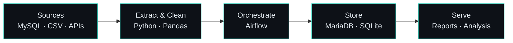

 Saudi Arabia ↗ &nbsp;·&nbsp; Available for freelance

 

 

<table>
<tr>
<td width="62%" valign="top">

 ## About

 I'm a recent software engineering graduate moving into **data engineering**.
 I enjoy the part of data work that most people never see: the plumbing that
 makes numbers trustworthy: ingestion, transformation, scheduling, and storage.

 I come from a software background, so I tend to think in systems first:
 clear structure, small reusable steps, and pipelines that fail loudly instead of silently.

 **Right now**
 - Building pipelines with Python, SQL and Airflow
 - Learning cloud fundamentals on AWS
 - Taking freelance data work
</td>
<td width="38%" align="center" valign="middle">

<!-- Put your picture here (square, ~300px). Delete this comment when ready:

-->

</td>
</tr>
</table>

 

### How I think about a pipeline

 

### Stack

**Data engineering** (my focus)

**Cloud & DevOps**

**Analysis & ML basics**

<b>Software engineering background</b>

 

<b>Workflow</b>

 

 

### Featured projects 

| Project | What it does | Stack |
|---|---|---|
| **[project-name](https://github.com/mira-coding/project-name)** | One sentence: the problem and the result | `Python` `Airflow` `MariaDB` |
| **[project-name](https://github.com/mira-coding/project-name)** | One sentence: the problem and the result | `Python` `SQL` `Docker` |

for more visit my Portfolio: <a href="https://portfolio-tipl.onrender.com/">Portfolio↗</a>
 

### Work with me

I take on freelance work in:

- **ETL / ELT pipelines**: pulling data from files, APIs and databases into a clean store
- **SQL & database work**: schema design, query cleanup, migrations
- **Automation**: scheduled jobs and reports with Python and Airflow

Message me on [LinkedIn](https://www.linkedin.com/in/amirah-mohsen-اميرة-محسن-258684273/) or by [email](mailto:ameramohsen.silver@gmail.com).

 

### Activity

<picture>
  <source media="(prefers-color-scheme: dark)" srcset="https://streak-stats.demolab.com/?user=mira-coding&theme=dark&hide_border=true&background=00000000" />
  
</picture>
<picture>
  <source media="(prefers-color-scheme: dark)" srcset="https://github-readme-stats.shion.dev/api/top-langs/?username=mira-coding&theme=transparent&hide_border=true&layout=compact&text_color=c9d1d9&title_color=e68002" />
  
</picture>

